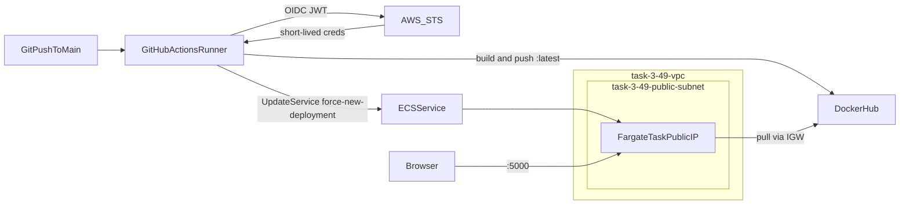

# Task 3.49 - CI/CD: Build, Push to Docker Hub & Deploy to ECS via GitHub OIDC

Every push to `main` builds a Flask image, pushes it to Docker Hub as `:latest`, and force-redeploys an ECS Fargate service. AWS authentication uses **GitHub OIDC** - there are no AWS keys anywhere in GitHub.



## Repository layout

```
.
├── app.py                          # Flask app, "/" returns Hello
├── requirements.txt
├── Dockerfile                      # python:3.12-slim, non-root, gunicorn on :5000
├── .github/workflows/deploy.yml    # CI/CD pipeline
└── terraform/
    ├── bootstrap/                  # one-time: S3 bucket for remote state (local state)
    ├── modules/github-oidc-role/   # OIDC provider (create or reuse) + role + inline policy
    ├── backend.tf                  # S3 backend, native lockfile (no DynamoDB)
    ├── network.tf                  # VPC module (1 AZ, 1 public subnet, IGW, no NAT) + SG module
    ├── ecs.tf                      # ECS module: Fargate cluster + service, public IP, no ALB
    ├── iam.tf                      # task-3-49-github-actions-role + task-3-49-deploy-policy
    ├── variables.tf / locals.tf / outputs.tf / providers.tf / versions.tf
    ├── backend.hcl.example
    └── terraform.tfvars.example
```

| Resource | Name |
|---|---|
| VPC / subnet / SG | `task-3-49-vpc`, `task-3-49-public-subnet`, `task-3-49-sg` |
| ECS cluster / service | `task-3-49-cluster`, `task-3-49-service` |
| IAM role / policy | `task-3-49-github-actions-role`, `task-3-49-deploy-policy` |
| State bucket | `task-3-49-tfstate-<account-id>` |

## Prerequisites

- Terraform >= 1.10, AWS CLI v2 authenticated to the target account (admin or equivalent for the initial apply).
- A Docker Hub account, a **public** repository (e.g. `<user>/task-3-49-flask`), and an access token (Account settings -> Personal access tokens, Read & Write).
- A GitHub repository containing this directory as its root.

## Runbook

### 1. Bootstrap remote state (one-time)

```bash
cd terraform/bootstrap
terraform init
terraform apply
# note the output: state_bucket_name
```

### 2. Configure the main stack

```bash
cd ..   # terraform/
cp backend.hcl.example backend.hcl            # set bucket = <state_bucket_name>
cp terraform.tfvars.example terraform.tfvars  # set dockerhub_image, github_owner, github_repo
```

Check whether the account already has a GitHub OIDC provider. If it does, set `create_oidc_provider = false`:

```bash
aws iam list-open-id-connect-providers | grep token.actions.githubusercontent.com
```

### 3. (Recommended) Push the first image by hand

The service pulls `:latest` as soon as it is created. If the image does not exist yet, tasks fail to start until the pipeline runs for the first time (the service keeps retrying, so this is self-healing, just noisy). To avoid it:

```bash
docker login -u <user>
docker build --platform linux/amd64 -t <user>/task-3-49-flask:latest .
docker push <user>/task-3-49-flask:latest
```

### 4. Apply infrastructure

```bash
terraform init -backend-config=backend.hcl
terraform fmt -check -recursive && terraform validate
terraform plan -out=tfplan
terraform apply tfplan
terraform output github_actions_role_arn
```

### 5. Configure GitHub

Repository -> Settings -> Secrets and variables -> Actions:

| Kind | Name | Value |
|---|---|---|
| Secret | `DOCKERHUB_USERNAME` | your Docker Hub username |
| Secret | `DOCKERHUB_TOKEN` | the Docker Hub access token |
| Variable | `AWS_ROLE_ARN` | output `github_actions_role_arn` |

`AWS_ROLE_ARN` is a variable, not a secret: a role ARN is an identifier, not a credential. Without a valid OIDC token from this repo's `main` branch it is useless.

If you change `AWS_REGION` or `IMAGE_NAME` from the defaults, update the `env:` block in [deploy.yml](.github/workflows/deploy.yml) to match `aws_region` and `dockerhub_image` in `terraform.tfvars`.

### 6. Deploy

Edit the message in `app.py`, commit, and push to `main`. Watch the Actions tab: checkout -> OIDC credentials -> Docker Hub login -> build & push -> force new deployment -> wait for stable.

## Verification

```bash
# App URL (the IP changes with every deployment)
eval "$(terraform -chdir=terraform output -raw get_task_public_ip_command)"
curl http://<public-ip>:5000/

# Deployments: a new PRIMARY appears after each pipeline run, the old one drains to 0
aws ecs describe-services --cluster task-3-49-cluster --services task-3-49-service \
  --query 'services[0].deployments[].{status:status,rollout:rolloutState,running:runningCount,created:createdAt}' --output table

# Trust policy: scoped to repo:<owner>/<repo>:ref:refs/heads/main
aws iam get-role --role-name task-3-49-github-actions-role --query 'Role.AssumeRolePolicyDocument'

# Permissions: only ecs:UpdateService + ecs:DescribeServices on the service ARN
aws iam get-role-policy --role-name task-3-49-github-actions-role --policy-name task-3-49-deploy-policy

# No AWS secrets in the repo (only DOCKERHUB_*)
gh secret list
```

In CloudTrail, the pipeline's calls appear as `AssumeRoleWithWebIdentity` followed by `UpdateService`, with session name `gha-<run_id>-<attempt>`.

## Teardown

```bash
terraform -chdir=terraform destroy
# the state bucket has force_destroy = false; empty it (all versions) first, then:
terraform -chdir=terraform/bootstrap destroy
```

## Mandatory questions

### 1. What is OIDC and how does GitHub Actions use it to authenticate to AWS without stored credentials?

OpenID Connect is an identity layer on top of OAuth 2.0: an identity provider issues signed JSON Web Tokens (JWTs) that describe *who* the caller is. GitHub runs an OIDC provider at `https://token.actions.githubusercontent.com`.

1. The workflow has `permissions: id-token: write`, so the job can request a JWT from GitHub. The token is signed by GitHub and contains claims such as `iss`, `aud` (`sts.amazonaws.com`), `sub` (`repo:<owner>/<repo>:ref:refs/heads/main`), `repository`, `ref`, `sha`, `run_id`, and a ~5 minute expiry.
2. `aws-actions/configure-aws-credentials` sends that JWT to AWS STS via `AssumeRoleWithWebIdentity`, naming `task-3-49-github-actions-role`.
3. STS verifies the signature against GitHub's public keys (from the registered IAM OIDC identity provider), then evaluates the role's trust policy conditions on `aud` and `sub`.
4. If they match, STS returns temporary credentials (access key, secret key, session token) valid for at most one hour. They live only in the runner's environment for that job.

Nothing long-lived exists to leak or rotate: the JWT is single-use and short-lived, and the AWS credentials expire on their own.

### 2. The trust policy is scoped to `repo:your-org/your-repo:ref:refs/heads/main`. Can a PR from a fork assume the role?

No. For a `pull_request` event the `sub` claim is `repo:<owner>/<repo>:pull_request`, which does not equal the allowed `...:ref:refs/heads/main` (the condition is `StringEquals`, not `StringLike`), so STS returns `AccessDenied` on `AssumeRoleWithWebIdentity` and the job fails at the credentials step. On top of that, for PRs from forks GitHub does not grant `id-token: write` (no OIDC token at all) and does not pass repository secrets, so the Docker Hub login fails too. The same applies to a push to any other branch in the main repo (`sub` = `...:ref:refs/heads/feature-x`). Only code that has actually been merged into `main` can deploy. This workflow also only triggers on `push` to `main`, so a PR does not run it in the first place.

### 3. Why doesn't ECS pick up a new `:latest` automatically? What does `--force-new-deployment` do?

ECS only acts when the *service* changes (task definition revision, desired count, network config, and so on). Pushing a new image to Docker Hub changes nothing in AWS: the task definition still says `<user>/task-3-49-flask:latest`, the service is already at steady state, and ECS does not poll registries. Running tasks keep the image they pulled at start-up. ECS also resolves the tag to a digest when each task starts, so a running task is pinned to that digest.

`--force-new-deployment` creates a new deployment of the **same** task definition revision. The deployment controller starts new tasks; each one pulls the image again, so `:latest` resolves to the newest digest. With `minimumHealthyPercent = 100` and `maximumPercent = 200`, ECS starts the new task first, waits for it to reach `RUNNING` and pass its container health check, then stops the old task (SIGTERM, then SIGKILL after the stop timeout). The deployment circuit breaker rolls back if the new tasks keep failing.

### 4. The policy only allows `ecs:UpdateService`. What if someone changes the workflow to call `ecs:DeleteService`?

The call is denied: `AccessDeniedException ... is not authorized to perform: ecs:DeleteService on resource: ...task-3-49-service because no identity-based policy allows the ecs:DeleteService action`. IAM is default deny, and the role only has an explicit allow for two actions on one ARN. The same applies to the other cluster's services, `RegisterTaskDefinition`, `iam:*`, and so on. The attempt is still visible in CloudTrail. A malicious workflow change also has to land on `main` first (protected with required reviews), because the trust policy only accepts tokens from `main`.

Remaining risk: `UpdateService` alone can still change the desired count to 0 or point the service at a different existing task definition. Least privilege limits the blast radius but does not remove it, so branch protection and code review on `main` (including `.github/workflows/`) are part of the control.

### 5. What is the risk of `:latest` in production? What breaks if two developers push at the same time?

- **No traceability or reproducibility**: you cannot tell from the task definition which commit is running. "Rollback" means rebuilding old code, because the previous image was overwritten. The pipeline adds an OCI revision label, but the tag itself carries no version.
- **Non-deterministic scaling**: any task that starts later (autoscaling, a host or AZ failure, a restart) pulls whatever `:latest` is *at that moment*, so tasks in the same service can run different code without any deployment happening.
- **Concurrent pushes**: two runs race. Run A pushes `:latest`, then run B overwrites it, and both trigger force deployments. Depending on timing, A's deployment may end up running B's image, or the tasks from A's deployment pull an image that is replaced moments later. The final state is "whatever was pushed last", which may not be the last commit merged. Workflow logs can say "deployed A" while B is actually running. This repo serialises runs with `concurrency: deploy-<ref>` (`cancel-in-progress: false`), which removes the race, but the real fix is immutable tags (Git SHA or semver) plus registering a new task definition revision per deploy (or pinning `@sha256:` digests).

### 6. Docker Hub credentials are GitHub secrets. Why is that acceptable, but AWS keys are not?

Both are long-lived static credentials stored in GitHub. The difference is the availability of an alternative and the blast radius:

- **AWS supports OIDC federation**, so storing static IAM access keys is an avoidable risk. IAM user keys never expire unless rotated manually, work from anywhere on the internet, and often carry broad permissions. If one leaks (logs, a malicious action, a compromised dependency, a forked workflow), an attacker has persistent access to your cloud account, which can mean data exfiltration, crypto-mining, or deleting infrastructure.
- **Docker Hub has no OIDC trust for GitHub Actions** in this setup, so a secret is the only option. The risk is contained: it is a scoped *access token* (not the account password), it only grants push/pull on Docker Hub, and it can be revoked independently. A leak lets someone push a malicious `:latest`, which is serious (supply chain) but bounded. Mitigations: a token scoped to Read & Write on a single repository, rotation, and GitHub masking secrets in logs.

Rule of thumb: use federated, short-lived identity wherever the target supports it; fall back to narrowly scoped, revocable tokens only where it does not.

### 7. During the force redeployment, what happens to requests while the old task drains and the new task starts?

There is no load balancer, and each Fargate task has its **own** public IP, so there is no stable endpoint to shift traffic between:

- While both tasks run (the 200% max), the **old IP keeps serving** (old version) and the **new IP serves** the new version once it is up. Clients only reach the new version if they switch to the new IP.
- When ECS stops the old task, its ENI and public IP are released. In-flight requests to it may be cut off (gunicorn gets SIGTERM and finishes in-flight requests within the stop timeout), and new requests to the old IP time out or are refused.

So from a user's perspective this is a **downtime event plus an endpoint change**. With an ALB, the new task is registered and must pass the target-group health checks before the old one is deregistered, and connection draining (`deregistration_delay`) lets in-flight requests finish. Clients keep one DNS name, so the rollout has zero downtime. ECS Service Connect or a stable DNS name (Cloud Map) are other options.

### 8. How would you deploy only on a Git tag (e.g. `v1.0.0`)?

1. Trigger on tags instead of `main`:

   ```yaml
   on:
     push:
       tags: ["v*.*.*"]
   ```

2. Update the trust policy, because the `sub` claim becomes `repo:<owner>/<repo>:ref:refs/tags/v1.0.0`. Use `StringLike` on `repo:<owner>/<repo>:ref:refs/tags/v*` (a wildcard on the tag only, never on the repo). Protect `v*` tags with tag rulesets so only maintainers can create them. Optionally also require the tagged commit to be on `main`.
3. Push the versioned tag, for example via `docker/metadata-action`, which generates `1.0.0`, `1.0` and `sha-<short>` tags. Keep `:latest` only as a convenience pointer.
4. Deploy the exact version instead of force-redeploying `:latest`: render a new task definition with the image `<user>/task-3-49-flask:1.0.0` (`aws-actions/amazon-ecs-render-task-definition` + `amazon-ecs-deploy-task-definition`). This needs `ecs:RegisterTaskDefinition` and `iam:PassRole` on the execution role in the deploy policy. Rollback then means redeploying the previous task definition revision.
