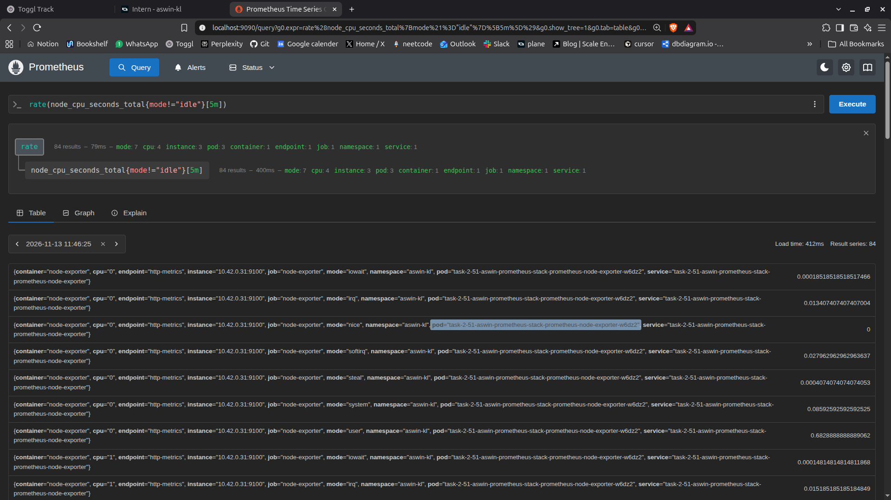
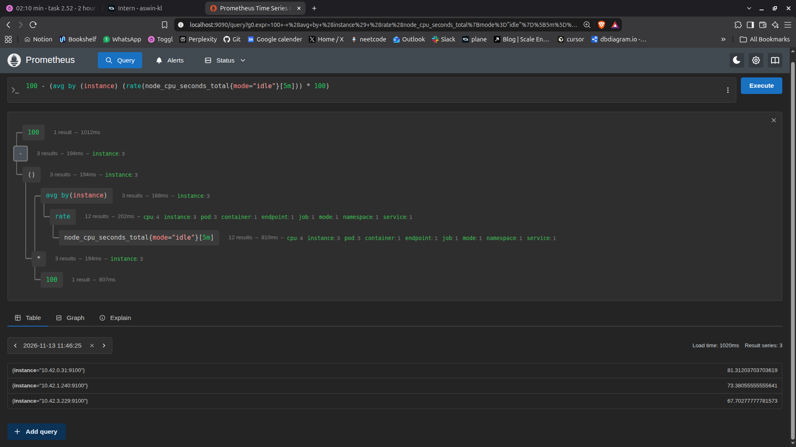
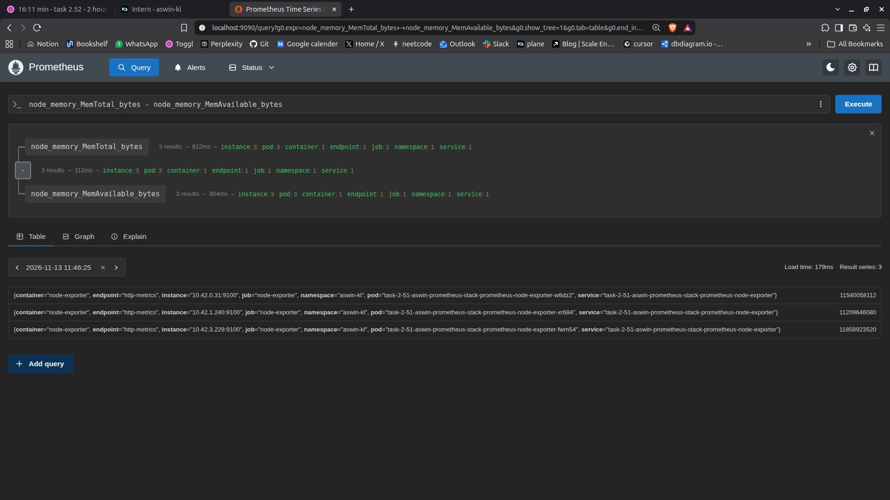
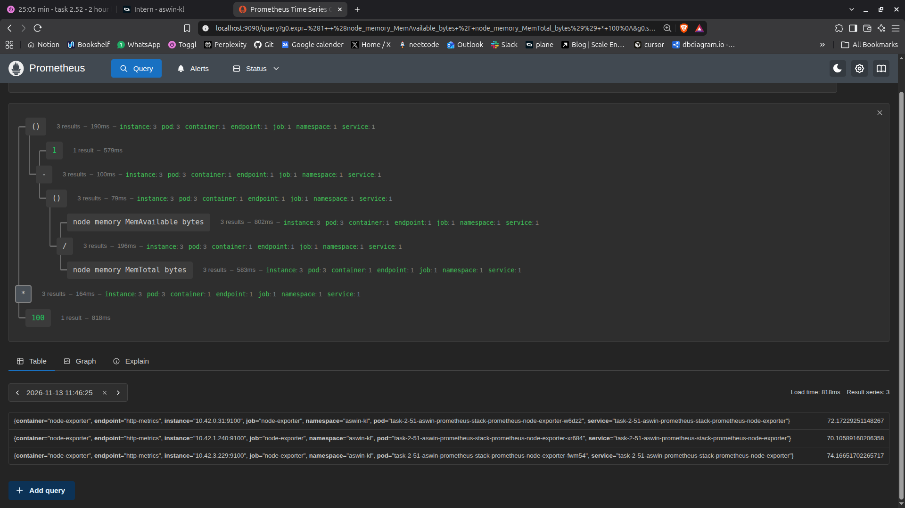
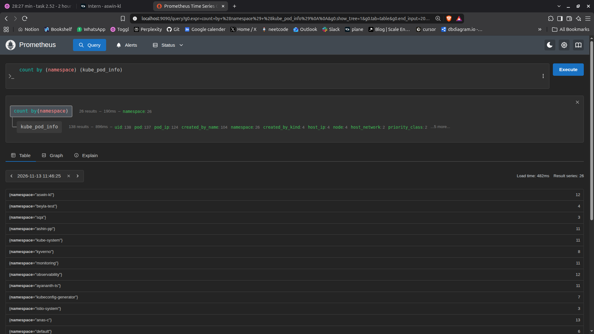
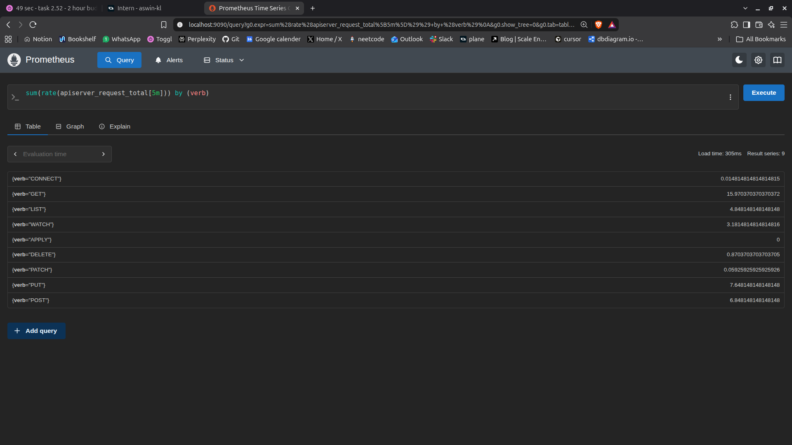
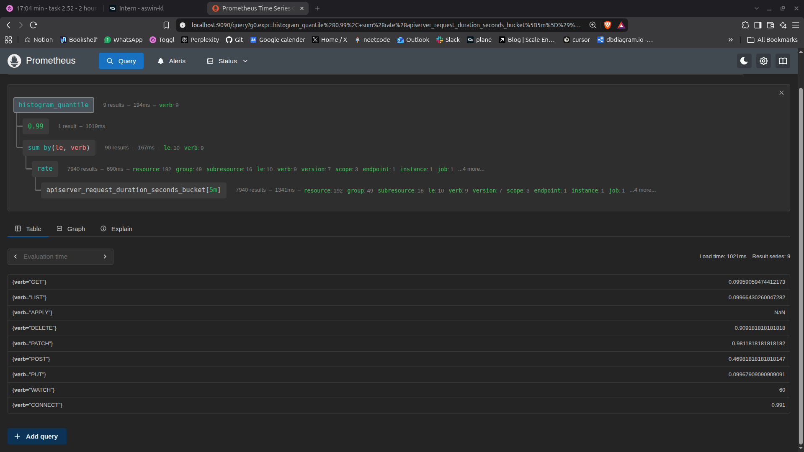
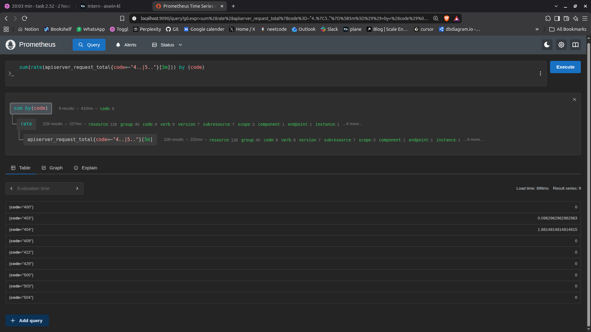

1. CPU usage rate per node (all cores, excluding idle)

```
rate(node_cpu_seconds_total{mode!="idle"}[5m])
```

i observe that we have 3 instances . and we have 7 mods and we have 84 time series
the promql query is to get the average per sec usage of cpu for the last 5 min where the cpu mode is not idle



2. Total CPU usage percentage per node:

```
100 - (avg by (instance) (rate(node_cpu_seconds_total{mode="idle"}[5m])) * 100)

```

i observed that we can see the how much per of cpu was using from each of the node in the last 5 min



3. Memory used per node (bytes):

```
node_memory_MemTotal_bytes - node_memory_MemAvailable_bytes
```

it is about the memeory usage on each node .
by subtracting total from the avaialble we get the current usage .



4. Memory usage percentage per node:

```
(1 - (node_memory_MemAvailable_bytes / node_memory_MemTotal_bytes)) * 100
```

this tells us how much memeory is used in percentage .



5. Total number of running pods per namespace:

```
count by (namespace) (kube_pod_info)
```



6.API server request rate by HTTP verb:

```
sum(rate(apiserver_request_total[5m])) by (verb)

```

i observed that we got a lof of get command per sec than others . it show the avg req per sec and add all of it and group it by verb a


7. P99 latency of API server requests (seconds):

```
histogram_quantile(0.99, sum(rate(apiserver_request_duration_seconds_bucket[5m])) by (le, verb))

```

this show how long the 99 per of the k8s api server req takes. grouped by the verb



8. API server error rate (4xx and 5xx only):

```
sum(rate(apiserver_request_total{code=~"4..|5.."}[5m])) by (code)

```

this uses the regex to to get all the code that start with 5 and 4 and then get the avg per sec and then get the sum of all of it and groupp by the code .


