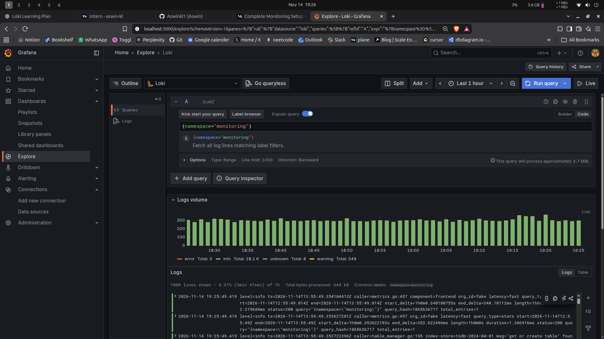
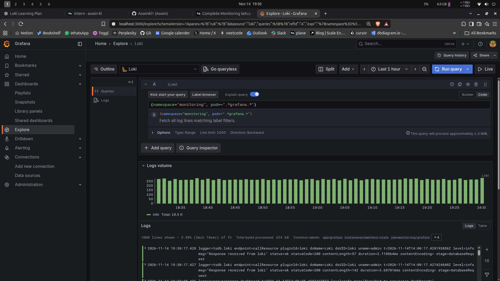
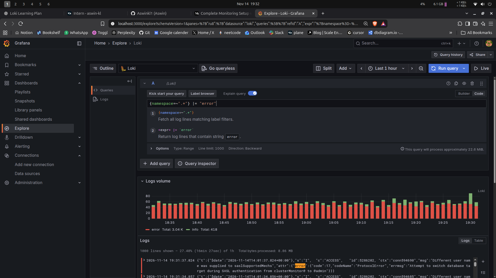
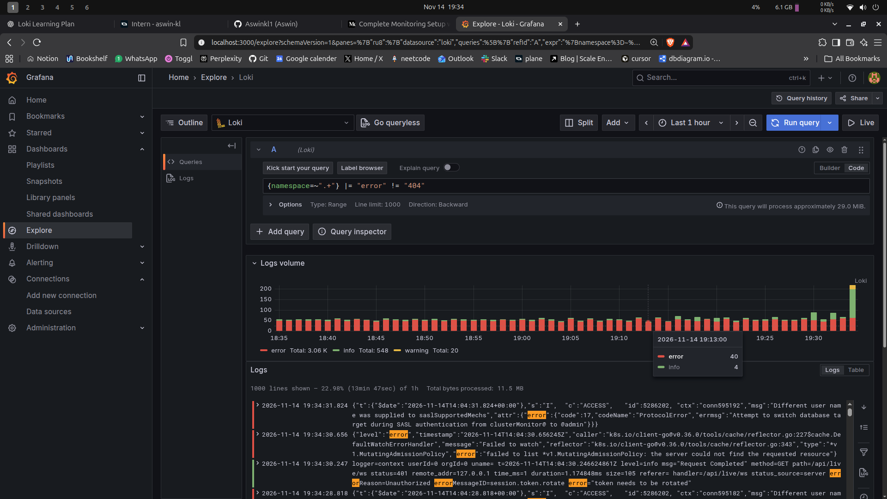
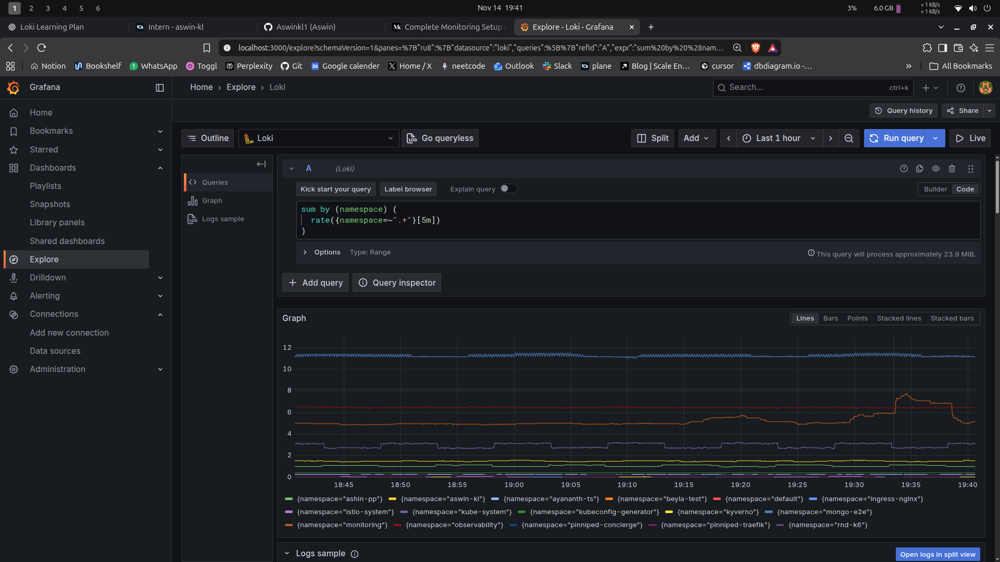
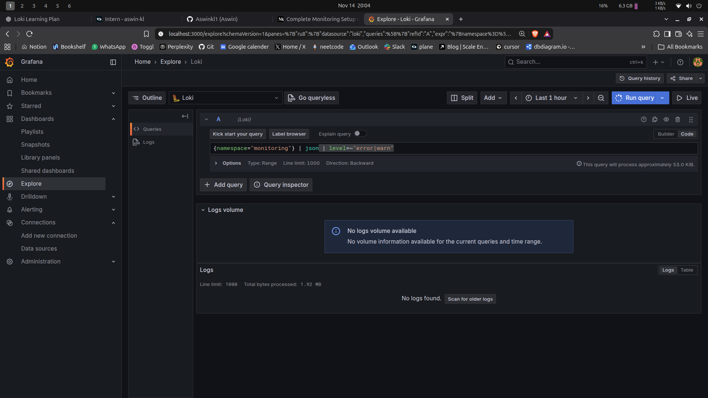

# stream selector

## All logs from the monitoring namespace:

```
{namespace="monitoring"}
```

this gives us all the logs from the monitoring namespace



## Logs from all Grafana pods specifically

```
{namespace="monitoring", pod=~"._grafana._"}
```

this filters namespace in the monitoring and then use regex for pod where if the pod label container graffana then it can get the logs .



# filter expression

## error from any pod

```
{namespace=~".+"} |= "error"
```

this gives us error logs from all of the namespace .



## error but not the 404

```
{namespace=~".+"} |= "error" != "404"
```

this give us error from all the namespace but exclude the 404 errors



# Metric query

## log line rate per sec grouped by namespace

```
sum by (namespace) (

rate({namespace=~".+"}[5m])

)
```

this get all the log from all the namsespace for the last 5 min . then get the per sec average log rate . add it and then group by namespace .



# parse fields

```
{namespace="monitoring"} | json | level=~"error|warn"
```

get the logs from the monitoring namespace and parse then into json . filter them with error or warn . but there are no logs right now .



# The difference between a stream selector and a filter expression

the diff is that a stream selector is used to select the stream and it uses labels to do it and its values are indexed . this is a must have value .

a filter expression is something that we uses to filter the logs bases on words or filter we use . this is an optional value

# Why Loki only indexes labels and not log content, and what trade-off this creates

loki only index the labels because indexing all of logs makes the index big and we need to store the index in someplace too . that become very expensive if out cluster is really big or we get a lot of logs

if we only index the label the index becomes very small and the cost is smaller too .

the tradeoff is that it might get slower for larger logs like if we have a stream group with a lot of logs getting and filter get a bit slower .
