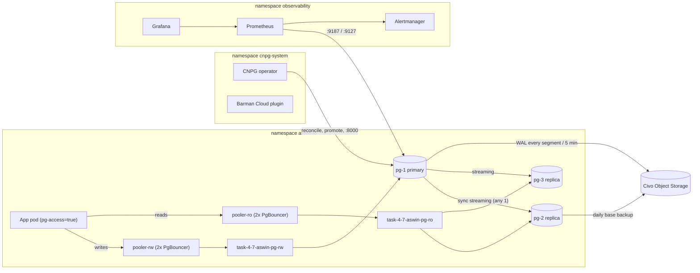
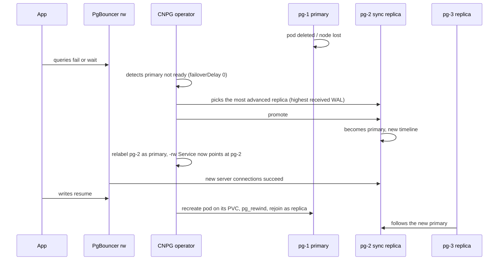

# Architecture — Production PostgreSQL on Kubernetes

## 1. What is deployed



| Component | Choice | Where |
|---|---|---|
| Operator | CloudNativePG 1.30.2 | `cnpg-system` (shared, pre-installed) |
| Postgres | 17.6, 3 instances (1 primary, 2 replicas), 5Gi `civo-volume` each | `aswin-kl` |
| Replication | Streaming, quorum synchronous: any 1 of 2 replicas must confirm each commit | |
| Pooling | 2 CNPG `Pooler`s (PgBouncer, transaction mode), 2 pods each: `rw` and `ro` | `aswin-kl` |
| Backups | Barman Cloud plugin v0.16: continuous WAL archiving + daily base backup, 7-day retention | Civo Object Storage, same region |
| Monitoring | CNPG metrics exporter + PodMonitors + PrometheusRule on the shared kube-prometheus-stack | `observability` |
| Security | Secrets created from env vars, NetworkPolicies, `pg_hba` reject-by-default, `app` role without superuser | |

### Why CloudNativePG over the alternatives

| | CloudNativePG | Zalando Postgres Operator | Percona Operator for PostgreSQL |
|---|---|---|---|
| Failover mechanism | Built into the operator, uses the Kubernetes API as the source of truth | Patroni inside each pod, with its own leader election | Patroni (based on Crunchy PGO) |
| Pod management | Manages Pods and PVCs directly (no StatefulSet) | StatefulSet | StatefulSet |
| Backups | Barman Cloud (plugin), WAL archiving + PITR | WAL-G / WAL-E | pgBackRest |
| Pooling | Built-in `Pooler` CRD | Built-in PgBouncer | Built-in PgBouncer |
| Monitoring | Prometheus exporter built into every instance, custom queries | Sidecar needed | PMM (Percona Monitoring and Management) |
| Governance | CNCF project | Zalando | Percona |

Reasons for choosing CNPG:

1. **Kubernetes-native.** No second consensus system (Patroni + etcd/endpoints) to understand and debug. The operator decides who the primary is and updates Services; there is one place to look.
2. **Everything this task needs is built in**: pooler, PITR, metrics, fencing, switchover, a `kubectl cnpg` plugin for operations.
3. **It was already installed and in use on this cluster** with the Barman Cloud plugin. Installing a second operator on a shared cluster would add risk for no benefit.
4. **Direct Pod/PVC management** lets CNPG choose which instance to recreate, and re-attach the existing volume, instead of the strict ordinal rules of a StatefulSet.

The Barman Cloud **plugin** is used rather than the older in-tree `spec.backup.barmanObjectStore`, which is deprecated in recent CNPG versions. The plugin runs as a sidecar in each instance pod and stores its configuration in a separate `ObjectStore` resource.

## 2. How a write travels

1. The app connects to `task-4-7-aswin-pooler-rw.aswin-kl.svc:5432` as user `app` (password from the `task-4-7-aswin-app-user` secret, mounted as env vars). TLS is required.
2. The NetworkPolicy on the pooler pods checks the source: only pods labelled `pg-access: "true"` in `aswin-kl` are allowed on 5432.
3. The Service load-balances the TCP connection to one of the 2 PgBouncer pods. PgBouncer authenticates the client with SCRAM, looking the password hash up through CNPG's `auth_query` (it logs in as `cnpg_pooler_pgbouncer` using a client certificate, not a password).
4. When the client starts a transaction, PgBouncer takes a free server connection from its pool (max 20 per pod) to the `task-4-7-aswin-pg-rw` Service. That Service's selector matches only the pod labelled `cnpg.io/instanceRole=primary`.
5. The NetworkPolicy on the instance pods allows 5432 from the pooler pods. `pg_hba` accepts only `hostssl app app ... scram-sha-256`; everything else is rejected.
6. The primary writes the change to its WAL and streams it to both replicas. Because of `synchronous: any 1`, `COMMIT` waits until **at least one replica has flushed the WAL to disk**.
7. The commit returns to PgBouncer, then to the app. PgBouncer puts the server connection back in the pool for the next client transaction.
8. Asynchronously, the Barman Cloud sidecar ships each completed 16 MB WAL segment (or every 5 minutes, `archive_timeout`) to the bucket.

## 3. How a read is routed differently

Same path, but:

- The app connects to `task-4-7-aswin-pooler-ro.aswin-kl.svc:5432`.
- That pooler sends server connections to `task-4-7-aswin-pg-ro`, whose selector matches pods with `cnpg.io/instanceRole=replica`. Connections are spread over both replicas.
- Replicas are in recovery mode (`pg_is_in_recovery() = true`): any write is rejected with `cannot execute ... in a read-only transaction`.
- The data can be slightly behind the primary (replication lag, see question 4).

CNPG also creates `task-4-7-aswin-pg-r` (any instance, including the primary). It is not used here.

**Which one the app uses:** all writes, and reads that must see the app's own latest write (read-after-write, e.g. "show the order I just placed"), go to `rw`. Reports, dashboards, search, listing pages and anything that tolerates data a few hundred milliseconds old go to `ro`.

## 4. What happens when the primary dies



Step by step:

1. The primary pod `pg-1` is killed (or its node dies). Its connections drop; in-flight transactions that had not committed are rolled back. Committed transactions are safe: each one is already on at least one replica because of synchronous replication.
2. The operator watches the pods. The primary is no longer ready, so the cluster phase becomes `Failing over`. With a node failure this takes until Kubernetes marks the pod not ready; with a pod deletion it is immediate.
3. The operator asks each remaining instance for its WAL position over the instance manager API (port 8000) and picks the most advanced replica.
4. It promotes it (`pg_promote`). The new primary starts a new timeline.
5. The operator moves the `cnpg.io/instanceRole=primary` label. The `-rw` Service endpoints now point to the new primary. No DNS change is needed; the Service name stays the same.
6. PgBouncer's existing server connections to the old IP fail; it opens new ones through the Service. Clients see errors for a few seconds, then writes succeed. Apps must retry failed transactions.
7. The other replica reconnects to the new primary.
8. The operator recreates the old primary's pod on its existing PVC. The instance manager runs `pg_rewind` to discard anything the old primary had that the new one does not, then it joins as a replica. The cluster is back to 3 healthy instances.

Expected write downtime is a few seconds for a pod deletion, and up to about a minute for a node failure (node-not-ready detection). The demo measures it from the gap in the `heartbeat` table.

**Why anti-affinity is "preferred", not "required":** there are exactly 3 nodes. With "required", if a node dies, the replacement instance has no free node and stays Pending until the node returns. With "preferred", the scheduler spreads instances across nodes normally but can co-locate temporarily during an outage.

**Why `dataDurability: required`:** with `preferred`, if both replicas were down, the primary would silently drop to asynchronous replication and a following failover could lose commits. With `required`, writes block instead. That is the correct trade-off when the requirement is "never lose committed data". Writes only block if **both** replicas are unavailable.

## 5. Backups and restore

### Where backups go

```
s3://<BUCKET>/task-4-7-aswin-pg/
  base/   one folder per base backup (compressed data directory copy)
  wals/   every WAL segment since the first backup (gzip)
```

- **WAL archiving**: continuous. Each finished WAL segment is uploaded by the Barman Cloud sidecar on the primary. `archive_timeout` forces a segment at least every 5 minutes, so at most ~5 minutes of WAL is ever only on the cluster disks (and that WAL is also on a synchronous replica).
- **Base backups**: `ScheduledBackup` daily at 02:00 UTC, taken from a replica (`target: prefer-standby`) so the primary is not loaded. `immediate: true` took the first one on creation. On demand: `03-backup/backup-now.yaml` or `kubectl cnpg backup`.
- **Retention**: 7 days. Older base backups, and WAL only needed by them, are deleted by the plugin.
- **Location**: Civo Object Storage in the same region as the cluster (low latency, no egress cost), outside the Kubernetes cluster, so the backups survive losing the whole cluster.
- **Credentials**: an S3 access key in the `task-4-7-aswin-s3-creds` secret, referenced by the `ObjectStore`.

### How to restore (point-in-time recovery)

Restores always go to a **new** cluster. The damaged cluster stays untouched, so you can compare before switching anything.

1. Find the moment just before the incident (application logs, `pg_stat_statements`, or the time the user reports), in UTC.
2. Set `recoveryTarget.targetTime` in [03-backup/restore-pitr.yaml](03-backup/restore-pitr.yaml).
3. `kubectl apply -f 03-backup/restore-pitr.yaml`. CNPG:
   - picks the latest base backup **before** the target time and downloads it;
   - downloads and replays WAL from the bucket up to the target time;
   - stops, promotes, and starts the cluster `task-4-7-aswin-pg-restore`.
4. Verify the data with `kubectl cnpg psql task-4-7-aswin-pg-restore -n aswin-kl -- app`.
5. Recover:
   - **Partial** (one table): `pg_dump -t <table>` from the restored cluster and load it into the live primary.
   - **Full**: point the poolers at the restored cluster (or rename it into place), scale it to 3 instances and add the backup plugin so it starts its own backup chain under a new `serverName`.

The restored cluster deliberately has no WAL archiver configured, so it cannot write into the original cluster's backup folder.

## 6. Monitoring and alerts

Every instance runs the CNPG metrics exporter on port 9187; each PgBouncer pod exports on 9127. Two `PodMonitor`s make the shared `observability` Prometheus scrape them every 30 seconds. Grafana shows the official CNPG dashboard (ID 20417). Alerts are in a `PrometheusRule` and go to the stack's Alertmanager.

| Alert | Fires when | Severity | Response |
|---|---|---|---|
| `Task47PostgresInstanceDown` | Fewer than 3 instances healthy for 2m | critical | `kubectl cnpg status`. Check pod events (scheduling, PVC, OOMKilled), node status. A failover may already have happened; confirm writes work. |
| `Task47PostgresReplicasNotStreaming` | Primary has fewer than 2 streaming replicas for 5m | warning | Logs of the missing replica. If it cannot catch up (WAL removed), delete its pod and PVC so CNPG re-clones it. |
| `Task47PgBouncerDown` | No healthy pod behind the write pooler for 2m | critical | `kubectl get pooler,pods`, pod events. The app cannot write; check the Deployment and the auth secret. |
| `Task47PostgresReplicationLagHigh` | A replica more than 30s behind for 2m | warning | Look for a long-running write (bulk load, migration) or a replica that is CPU/IO starved. Reads from `ro` are stale meanwhile; move critical reads to `rw` if needed. |
| `Task47PostgresReplicationLagCritical` | More than 5 minutes behind for 5m | critical | As above; consider re-cloning the replica. |
| `Task47PostgresDiskFillingUp` | Data volume less than 20% free for 5m | warning | Find the cause (table growth vs WAL piling up from failed archiving). Expand by raising `spec.storage.size` (the StorageClass supports expansion). |
| `Task47PostgresDiskWillFillIn6h` | Linear prediction: full within 6h | critical | Same, urgently. Postgres stops when the volume is full. |
| `Task47PostgresConnectionsNearMax` | More than 80% of `max_connections` used for 5m | warning | Find who connects directly (`pg_stat_activity`); everything should go through PgBouncer. Check pool sizes. |
| `Task47PgBouncerClientsWaiting` | Clients queueing in PgBouncer for 2m | warning | Slow queries holding server connections; look at `pg_stat_activity`. Raise `default_pool_size` only if Postgres has headroom. |
| `Task47PostgresWALArchivingFailing` | Archive failures in the last 5m | critical | Sidecar logs (`-c plugin-barman-cloud`): credentials, bucket, network. PITR is broken past the last archived WAL, and WAL accumulates on disk. |
| `Task47PostgresWALArchivingStale` | Primary has not archived for 15 minutes | warning | Same as above. |
| `Task47PostgresBackupTooOld` | Last successful base backup older than 26h | critical | `kubectl get backups`, `describe` the failed one. Take a manual backup. |
| `Task47PostgresBackupFailed` | Latest backup attempt failed | critical | Same. |
| `Task47PostgresBackupMetricsMissing` | No backup metrics for 30m | warning | The backup alerts are blind. Check that a backup ever completed and that the plugin reports metrics. |

## 7. Security

- **No plain-text credentials in manifests.** The app password and S3 keys are created with `01-secrets/create-secrets.sh` from environment variables. Manifests only reference secrets by name (`secretKeyRef`, `s3Credentials`). Replication and PgBouncer use client certificates generated by CNPG, not passwords.
- **No superuser for the app.** `enableSuperuserAccess: false` means no `postgres` password exists. The app connects as `app`, which owns only the `app` database and has no SUPERUSER, CREATEROLE, CREATEDB or REPLICATION attributes. Admin work is done with `kubectl cnpg psql`, which uses the local Unix socket inside the pod and requires Kubernetes RBAC to `exec`.
- **`pg_hba`**: after CNPG's fixed certificate rules, only `hostssl app app all scram-sha-256` is accepted; `host all all all reject` blocks every other network login (including any `postgres` login).
- **NetworkPolicy**: see question 9.
- **Pod security**: all pods run as non-root, without privilege escalation, with seccomp `RuntimeDefault`, enforced by the cluster's Kyverno policies.

---

## Mandatory questions

### 1. Why can you not just run Postgres as a Deployment with a single pod? What breaks?

- **Single point of failure.** When the pod or its node dies, the database is down until Kubernetes reschedules it, the volume detaches from the dead node and attaches to a new one. For a node failure that can take many minutes (pod eviction timeout plus volume detach timeout).
- **Deployments are built for stateless, interchangeable pods.** During a rolling update a Deployment starts the new pod before stopping the old one. Two Postgres processes on the same `ReadWriteOnce` volume either cannot start (volume still attached) or, in the worst case, corrupt the data directory.
- **No stable identity.** Replicas need to know who the primary is; Deployment pods get random names and IPs.
- **No replication, so no read scaling** and no copy of the data on another node.
- **Nothing understands Postgres.** Kubernetes restarts a crashed container but does not know about WAL, promotion, `pg_rewind`, backups or a safe shutdown (fast vs smart). A wrong shutdown or a restart loop during crash recovery causes longer outages.
- **No backups by default.** A PVC is not a backup: a deleted PVC, a corrupted volume or a `DELETE FROM` all lose data permanently.

### 2. What is a Kubernetes operator and why is it better than managing a StatefulSet yourself?

An operator is a controller running in the cluster that adds a custom resource (here `Cluster`, `Pooler`, `Backup`, `ScheduledBackup`) and continuously reconciles the real state with the declared state. It encodes the knowledge a human DBA would apply.

A StatefulSet gives stable names and per-pod volumes, but it does not know which pod is the primary. With a StatefulSet you would have to build yourself:

- replication setup and replica cloning (`pg_basebackup`)
- failure detection and choosing the most up-to-date replica
- promotion, and moving the write Service to the new primary
- fencing and `pg_rewind` for the old primary
- planned switchovers and rolling minor-version upgrades replicas-first
- WAL archiving, scheduled backups, retention and PITR restores
- TLS certificates, users, metrics

CNPG does all of this from about 80 lines of YAML, and it manages Pods and PVCs directly, so it can, for example, recreate a specific instance on its existing volume rather than following StatefulSet ordinal rules.

### 3. What is the difference between the read-write and read-only endpoints? When does your app use each?

- **Read-write** (`task-4-7-aswin-pooler-rw` -> Service `task-4-7-aswin-pg-rw`) always points at the current primary. It accepts reads and writes. Its target changes automatically on failover.
- **Read-only** (`task-4-7-aswin-pooler-ro` -> Service `task-4-7-aswin-pg-ro`) load-balances over the replicas. Writes are rejected. Data may lag slightly.

The app uses `rw` for all writes and for reads that must see the latest data (read-after-write, balances, anything inside a transaction that also writes). It uses `ro` for read-heavy, lag-tolerant traffic: reports, analytics, search, lists, dashboards. This takes read load off the primary so writes stay fast.

### 4. What is replication lag and what happens to reads during it?

Replication lag is how far a replica is behind the primary: WAL the primary has committed but the replica has not replayed yet, measured in bytes or seconds (`cnpg_pg_replication_lag`).

With quorum synchronous replication, at least one replica has the WAL **on disk** before a commit returns, but replicas still **apply** it asynchronously, and the second replica is not waited for. So during lag, a read on `ro` returns the old version of the data: a user can create a record and not see it on the next page load. Data is never wrong, only stale. Mitigations:

- send read-after-write traffic to `rw`;
- alert on lag (30s warning, 5m critical) and find the cause;
- if a replica falls too far behind it is effectively removed from rotation by fixing or re-cloning it.

### 5. What is connection pooling and why does Postgres need it on Kubernetes?

Postgres creates one OS process per connection, each using several MB of memory, plus CPU for authentication and process setup. Hundreds or thousands of connections exhaust memory and slow everything down through context switching and lock contention, which is why `max_connections` is low (100 here).

On Kubernetes this gets worse: every app replica has its own connection pool, HPA can scale apps from 3 to 30 pods in a minute, and each restart or rollout reconnects everything at once. 30 pods x 20 connections = 600 connections, more than Postgres allows.

A pooler (PgBouncer) sits in between. It accepts up to 1000 lightweight client connections per pod and multiplexes them onto a small pool of real Postgres connections (20 per PgBouncer pod). In **transaction** mode a server connection is only held for the duration of one transaction. In the demo, 500 pgbench clients run on about 40 Postgres backends. PgBouncer also gives the app one stable endpoint during failover.

Trade-off of transaction mode: session-level features (session `SET`, advisory locks held across transactions, `LISTEN/NOTIFY`, some prepared-statement uses) do not work. Apps needing those connect in session mode or directly.

### 6. What is the difference between a base backup and WAL archiving? Why do you need both?

- **Base backup**: a full physical copy of the data directory at one point in time. On its own it can only restore to that moment (for example 02:00), losing everything after.
- **WAL archiving**: a continuous stream of every change (the write-ahead log), uploaded segment by segment. On its own it is useless, because WAL is a list of changes and needs a starting copy to apply them to.

Together: restore the latest base backup before the target time, then replay archived WAL up to any second you choose. Base backups bound how much WAL has to be replayed (restore speed); WAL fills the gap between backups (recovery point, at most ~5 minutes of loss even if the whole cluster and its disks are lost).

### 7. What is point-in-time recovery and what problem does HA failover not solve?

PITR restores the database to its exact state at a chosen timestamp, by replaying WAL from a base backup and stopping just before that time.

HA failover protects against **infrastructure** failure: a dead pod, node or disk. It does not protect against **logical** failure, because replication faithfully copies every change, including mistakes. A `DELETE FROM customers` without a `WHERE`, a bad migration that drops a column, an application bug writing garbage, or a compromised account encrypting data, all reach both replicas within milliseconds. Failing over just gives you another copy of the broken data. Only PITR, from backups stored outside the cluster, brings back the data as it was at 14:31:59, one second before the mistake.

### 8. What does your monitoring alert on and how would you respond to each alert?

See the table in [section 6](#6-monitoring-and-alerts). In short, alerts cover four areas:

- **Availability**: instances down, replicas not streaming, PgBouncer down.
- **Replication**: lag above 30 seconds (warning) and 5 minutes (critical).
- **Capacity**: disk below 20% or predicted full in 6 hours, connections above 80% of `max_connections`, clients queueing in PgBouncer.
- **Backups**: WAL archiving failing or stale, last base backup older than 26 hours, last backup failed, backup metrics missing.

The general response pattern: `kubectl cnpg status task-4-7-aswin-pg -n aswin-kl` first, then the pod events and logs of the affected instance, then the specific action in the table.

### 9. What does your NetworkPolicy allow and what does it block?

Two ingress policies, selecting only the database and pooler pods (other workloads in `aswin-kl` are unaffected).

**Allowed:**

| To | From | Port | Why |
|---|---|---|---|
| PgBouncer pods | Pods in `aswin-kl` labelled `pg-access: "true"` | 5432 | The application |
| PgBouncer pods | `observability` namespace | 9127 | Prometheus metrics |
| Postgres pods | PgBouncer pods of this cluster | 5432 | Pooled connections |
| Postgres pods | Other instances of the same cluster | 5432, 8000 | Streaming replication, `pg_basebackup`, instance status |
| Postgres pods | `cnpg-system` namespace (operator) | 8000 | Instance manager API: status, promote, fencing |
| Postgres pods | `observability` namespace | 9187 | Prometheus metrics |

**Blocked:**

- Any pod in any other namespace, including the other interns' namespaces.
- Pods in `aswin-kl` without the `pg-access: "true"` label, even if they have the correct password (the demo pod `task-4-7-aswin-pg-intruder` proves this; its connection times out).
- Direct connections from app pods to Postgres that bypass PgBouncer.
- Metrics ports from anywhere except `observability`.

Egress is not restricted, because the instances must reach the Kubernetes API and Civo Object Storage. Restricting it would be the next hardening step.

NetworkPolicy works at the network layer; `pg_hba` and SCRAM passwords work at the database layer. An attacker needs to pass both.

### 10. If you were handing this cluster to a new engineer at 2am, what would they need to know?

**Where things are**

- Namespace `aswin-kl`. Cluster `task-4-7-aswin-pg` (3 instances). Poolers `task-4-7-aswin-pooler-rw` / `-ro`.
- The operator and backup plugin are shared, in `cnpg-system`. **Do not modify or restart them**; other teams use them.
- Backups: `s3://<BUCKET>/task-4-7-aswin-pg/` in Civo Object Storage. S3 keys in secret `task-4-7-aswin-s3-creds`.
- Grafana and Prometheus: the shared `observability` stack (`kubectl port-forward -n observability svc/kube-prometheus-stack-grafana 3000:80`), CNPG dashboard.
- All manifests and the demo script are in this repository.

**First three commands**

```bash
kubectl cnpg status task-4-7-aswin-pg -n aswin-kl
kubectl get pods,pooler,backup -n aswin-kl -o wide
kubectl get events -n aswin-kl --sort-by=.lastTimestamp | tail -30
```

**Rules**

- **Never delete a PVC or the Cluster resource** to "fix" things. Deleting the Cluster deletes all three volumes.
- **Do not promote or edit pods by hand.** The operator owns them and will undo it. Use `kubectl cnpg promote` for a planned switchover, `kubectl cnpg fencing on|off` to isolate an instance, `kubectl cnpg restart` to restart.
- If a **failover happened**: check that the cluster is healthy and writes work. The old primary rejoins by itself. Nothing else to do at 2am.
- If **writes hang**: likely both replicas are down and `dataDurability: required` is protecting data. Bring a replica back; do not switch to async unless the business accepts possible data loss.
- If **data was deleted or corrupted**: do **not** fail over (replicas have the same damage). Note the time of the incident and restore to a new cluster with `03-backup/restore-pitr.yaml`. The original stays untouched.
- If **disk is filling**: check whether WAL archiving is failing first (`cnpg status` shows it). Expand with `spec.storage.size`; the volume grows online.
- If **archiving or backups fail**: check the `plugin-barman-cloud` container logs on the primary, then the bucket and credentials.
- **Admin access** is `kubectl cnpg psql task-4-7-aswin-pg -n aswin-kl`. There is no superuser password, by design.
- **Escalate** if the cluster shows no primary for more than 5 minutes, or a restore is needed in production.
